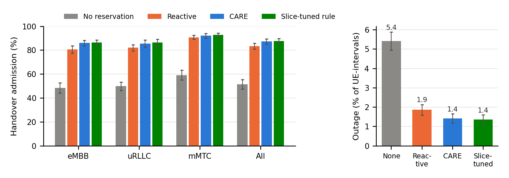
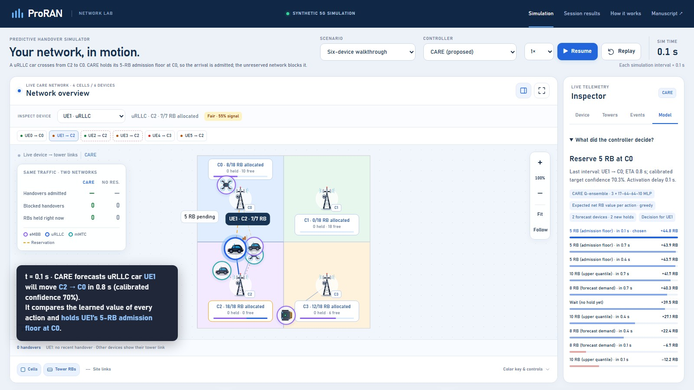
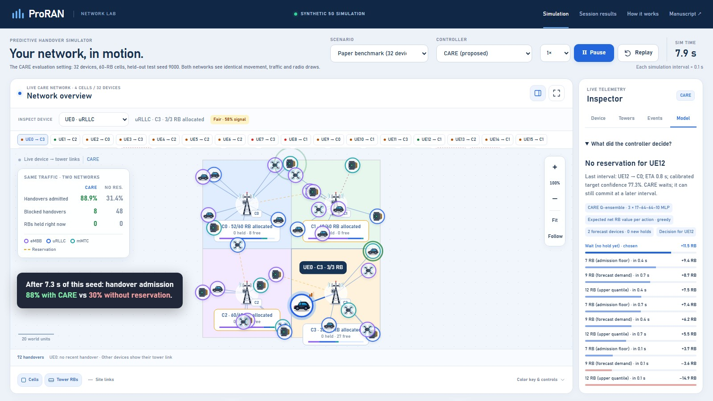

# CARE: proactive handover reservation for network-sliced 5G

**Paper:** *CARE: Calibrated, Counterfactually Attributed Proactive Resource Reservation for Network-Sliced 5G Handovers*. IEEE conference format, [paper/main.pdf](paper/main.pdf).

**Authors** (Department of Computer Science and Engineering, Indian Institute of Information Technology Dharwad):

| Roll No. | Name |
| --- | --- |
| 24BCS073 | Mayur Raju |
| 24BCS083 | Naramsetti Charan Raj Gupta |
| 24BCS095 | P Gnandeep |
| 24BCS100 | P Sanjay |
| 24BCS130 | S Sudharsan Reddy |
| 24BCS133 | Shaik Moiz |

## What this project does

When a device moves into a busy cell, it may not get the resource blocks (RBs) its slice needs, and the handover fails. Holding RBs at the target cell before the device arrives prevents that, but every held RB is taken from the devices already in that cell.

**CARE** (Calibrated, Attribution-Rewarded rEservation) is a learned controller that decides, for every device with a predicted handover, *whether* to hold capacity at the target cell, *how much* (slice minimum, forecast demand, or an upper quantile) and *when* to activate it. It has three parts:

1. **Calibrated target confidence.** A logistic model turns the neural mobility forecast into a probability that the predicted target cell is correct.
2. **Per-reservation counterfactual reward.** Each hold is credited only if it turned a failed admission into a success, and charged for exactly the incumbent RBs it displaced, at an operator price λ.
3. **Optimal-stopping learner.** Fitted Q iteration with a three-network ensemble learns when to wait and when to commit.

## Headline results (20 held-out test seeds, λ = 1)

| Method | Handover admission | Outage | Net utility (RB/interval) |
| --- | --- | --- | --- |
| No reservation | 51.6% | 5.42% | 0.00 |
| Reactive reservation | 83.5% | 1.87% | 10.71 |
| CARE without calibration | 84.2% | 1.78% | 12.15 |
| **CARE (proposed)** | **87.4%** | **1.42%** | **12.38** |
| Slice-tuned threshold rule | 87.9% | 1.37% | 12.65 |

Outage is the share of device-intervals spent re-establishing the radio link after a failed handover.



- CARE raises handover admission by about 36 points over no reservation, and cuts outage from 5.4% to 1.4%.
- It beats reactive reservation on admission by 3.9 points, winning on all 20 seeds (Holm-adjusted p = 0.0002).
- Calibration alone adds 3.2 points of admission (p = 0.0002, 19 of 20 seeds).
- CARE adapts to the displacement price: it holds on 24% of decisions at λ = 0.25 and on 2% at λ = 16.
- A carefully tuned threshold rule is as good or slightly better (CARE is within 0.6 RB per interval at every price). The paper reports this as a finding and explains why. It also shows why a PPO version of the same controller collapses to holding on every forecast.

Exact values, confidence intervals and all paired comparisons are in `results/care/summary.csv`, `results/care/paired.csv` and the paper's tables.

**Data:** all data are synthetic, generated by the simulator from fixed seeds; no external dataset is used. Radio, signaling and packet scheduling are abstracted, and signal and latency are modeled proxies, so the results are not field measurements or a 3GPP conformance claim.

## Course submission files

Build them with `python scripts/build_submission.py pdf standalone package`. The outputs go to `dist/`, which is not tracked in git.

| File | What it is |
| --- | --- |
| `paper/main.pdf` | The final paper (11 pages) |
| `dist/Overleaf_Source.zip` | The LaTeX project for Overleaf: New Project → Upload Project |
| `dist/Overleaf_SingleFile/` | One self-contained `main.tex` (results, tables and references inlined) and the 8 figures as PNG files, all in one folder. Paste `main.tex` into Overleaf and upload the PNGs next to it. |
| `dist/CARE_Final_Submission.zip` | Everything for the submission form: both Overleaf versions, the PDF, code, trained models, results, setup files and the revision report (about 14 MB) |
| `revision_reports/Revision_Report.docx` | Deep Review comments and the change made for each, round by round |
| [REPRODUCE.md](REPRODUCE.md) | Installation, data, seeds, settings and the exact command behind every figure and table |

## Run the live demo

The trained models are included, so you don't need to retrain anything.

**Windows (PowerShell), from the project folder:**

```powershell
.\bootstrap.ps1                          # first time only: creates .venv and installs packages
.\.venv\Scripts\python.exe -m web.server
```

**Linux / macOS:**

```sh
python3 -m venv .venv && . .venv/bin/activate
python -m pip install -r requirements.txt -r requirements-web.txt -r requirements-dev.txt
python -m pip install -e . --no-build-isolation
python -m web.server
```

Then open <http://127.0.0.1:8080> in a browser. To use a different port, set `PRORAN_PORT` first (PowerShell: `$env:PRORAN_PORT = "8081"`).

### What you see

The map shows two identical networks side by side in time. The only difference is the reservation policy: **CARE** vs **no reservation**. Both use the same device movement, traffic and radio randomness.

- **Scoreboard** (top left of the map) compares the two networks live: handovers admitted, handovers blocked, and RBs CARE is holding right now.
- **Towers** show allocated / held / free RBs. The ring around each device shows its slice: eMBB purple, uRLLC blue, mMTC teal. The icon (car, drone, robot) is only decoration.
- **Lines** link each device to its serving cell. Dashed amber lines are reservations: faint while pending, solid once the RBs are held at the target.
- **Handovers** flash green (admitted) or red (blocked). The selected device also gets an arrow and a label.
- **Inspector → Model** shows CARE's decision for the selected device. For each action it gives the predicted target, the calibrated confidence, and the learned value in RB.
- **Session results** (scroll down) has sparklines of cumulative admission and QoS for CARE (solid) and no reservation (dashed).

Suggested walkthrough:

1. **Scenario "Six-device walkthrough"**, press Play. At 0.7 s, the uRLLC car UE1 crosses from C2 to C0. CARE has held its 5-RB admission floor at C0, so the handover is *admitted*; the unreserved network *blocks* it (only 3 RB free).
2. **Scenario "Seven-cell cluster"** shows ten devices on a hexagonal layout.
3. **Scenario "Paper benchmark (32 devices)"** is the exact evaluation setting from the paper (held-out test seed 9000).
4. **Controller "Forecast rule + QoS-aware target"** is a fixed-rule comparison. It picks the target cell by load, signal and latency instead of distance.

Controls: the speed menu next to Play sets 0.5×–4× playback. Space pauses, arrow keys pan, F fits the map. Zoom with the mouse wheel or pinch, and drag to pan. *Replay* restarts the same seed.

A recorded, captioned demo (94 s) is in [results/demo/care_demo.mp4](results/demo/care_demo.mp4).

| CARE explains its decision | The paper's benchmark (32 devices) |
| --- | --- |
|  |  |


## Verify everything

```sh
python -m pytest -q                       # 107 unit, integration and paper-traceability tests (about 15 s)
python -m ruff check src web tests scripts
python -m ruff format --check src web tests scripts
python -m compileall -q src web
```

With the server running, the browser test drives the real UI in headless Microsoft Edge (Node.js 22+):

```sh
node tests/browser_smoke.mjs
```

Set `PRORAN_BROWSER` to another Chromium executable or `PRORAN_URL` to another server address if needed.

## Reproduce the study

```sh
python -m proran.care_experiment            # calibrate, train, tune, evaluate, report (about 47 min on 16 threads)
python -m proran.care_experiment tune evaluate report   # re-evaluate the saved models (about 6 min)
python -m proran.care_experiment report     # rebuild tables, figures and numbers from saved runs (about 15 s)
python scripts/build_submission.py sync     # copy the new tables, figures and numbers into paper/
```

**Verified end to end:** a fresh clone, a new virtual environment and the full pipeline reproduced all 33 trained models byte for byte, and every held-out run, statistic, table and paper number exactly. Only wall-clock timings differ. Details are in [REPRODUCE.md](REPRODUCE.md).

Seed roles never overlap:

| Role | Seeds |
| --- | --- |
| Forecaster training | 3000–3023 |
| Forecaster validation | 4000–4005 |
| Calibration | 4100–4119 |
| CARE training (replicas 101, 102, 103) | 21000–21239, 22000–22239, 23000–23239 |
| Rule tuning and replica selection | 5000–5009 |
| Held-out test | 9000–9019 |

Outputs go to `results/care/`. Every number in `paper/main.tex` is a macro generated from those results. Tests check that the paper contains no hand-typed results and that `paper/` matches `results/care/` byte for byte. The neural forecaster can be retrained with `python -m proran.neural` (writes `results/deep/`).

## Project layout

| Path | Purpose |
| --- | --- |
| `src/proran/simulator.py`, `config.py`, `models.py`, `geometry.py`, `actions.py` | Sliced multi-cell RAN simulator: mobility, scheduling, reservation contracts, handover admission, counterfactual accounting |
| `src/proran/neural.py` | Neural mobility/demand forecaster (35–64–32–24 MLP) |
| `src/proran/calibration.py` | Logistic calibration of target confidence |
| `src/proran/care.py` | CARE: contract reward, fitted-Q learner, Q-ensemble, PPO ablation |
| `src/proran/care_experiment.py` | End-to-end experiment: calibrate, train, tune baselines, evaluate on held-out seeds |
| `src/proran/care_report.py` | Statistics (paired tests, Holm), tables, figures, paper macros |
| `web/server.py`, `web/static/` | Flask/Waitress API and the interactive network map |
| `tests/` | Python tests and the browser UI test |
| `results/care/` | Calibrator, trained models, raw per-seed runs, statistics, figures, paper macros |
| `results/deep/` | Trained forecaster and its training record |
| `results/demo/` | Demo video and screenshots |
| `paper/` | Final IEEE conference paper: `main.tex`, `main.pdf`, `references.bib`, figures, generated tables and macros |
| `scripts/build_submission.py` | Sync results into the paper, compile it, build the single-file Overleaf version and the submission zips |
| `revision_reports/` | Deep Review comments and revision log |
| `docs/` | Original problem statement and project brief (the PreNS reference paper is cited in the paper, not redistributed) |
| `REPRODUCE.md` | Install, data, seeds, settings and exact commands for every result |

## Container

```sh
docker build -t proran-ui .
docker run --rm -p 8080:8080 proran-ui
```
