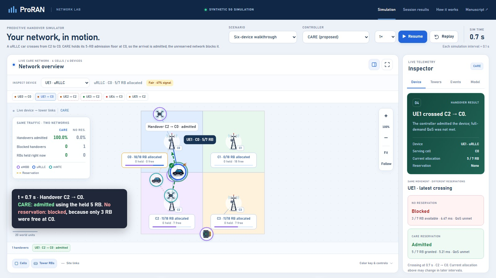

# ProRAN / CARE: proactive handover reservation for sliced 5G

When a device moves into a busy cell, it may not get the resource blocks (RBs) its slice needs, and the handover fails. Holding RBs at the target cell before the device arrives prevents that, but every held RB is taken from the devices already in that cell.

**CARE** (Calibrated, Attribution-Rewarded rEservation) is a learned controller that decides, for every device with a predicted handover, *whether* to hold capacity at the target cell, *how much* (slice minimum, forecast demand, or an upper quantile) and *when* to activate it. It has three parts:

1. **Calibrated target confidence.** A logistic model turns the neural mobility forecast into a probability that the predicted target cell is correct.
2. **Per-reservation counterfactual reward.** Each hold is credited only if it turned a failed admission into a success, and charged for exactly the incumbent RBs it displaced, at an operator price λ.
3. **Optimal-stopping learner.** Fitted Q iteration with a three-network ensemble learns when to wait and when to commit.

The full study is in [paper/main.pdf](paper/main.pdf) (IEEE conference format; LaTeX source in [paper/](paper/)). Step-by-step reproduction instructions are in [REPRODUCE.md](REPRODUCE.md).

## Headline results (20 held-out seeds, λ = 1)

| Method | Handover admission | Outage | Net utility (RB/interval) |
| --- | --- | --- | --- |
| No reservation | 51.6% | 5.4% | 0.00 |
| CARE (proposed) | 87.4% | 1.4% | 12.38 |
| CARE without calibration | 84.2% | 1.8% | 12.15 |
| Slice-tuned threshold rule | 87.9% | 1.4% | 12.65 |

Outage is the share of device-intervals spent re-establishing the link after a failed handover.

- CARE raises handover admission by about 36 points over no reservation.
- Calibration alone adds about 3.2 points of admission (p = 0.0002).
- CARE adapts how often it holds to the displacement price λ.
- A well-tuned threshold rule is as good or slightly better (within 0.6 RB/interval at every price). The paper reports this honestly as a finding.

Exact values, confidence intervals and all comparisons are in `results/care/summary.csv`, `results/care/paired.csv` and the paper tables.

Radio, signaling and packet scheduling are abstracted. Signal and latency are modeled proxies, so the results are not field measurements or a 3GPP conformance claim.

## Run the live demo

The trained models are included, so you don't need to retrain anything.

**Windows (PowerShell), from the project folder:**

```powershell
.\bootstrap.ps1                          # first time only: creates .venv and installs packages
.\.venv\Scripts\python.exe -m web.server
```

**Linux / macOS:**

```sh
python3 -m venv .venv && . .venv/bin/activate
python -m pip install -r requirements-dev.txt -r requirements-web.txt
python -m pip install -e . --no-build-isolation
python -m web.server
```

Then open <http://127.0.0.1:8080> in a browser. To use a different port, set `PRORAN_PORT` first (PowerShell: `$env:PRORAN_PORT = "8081"`).

### What you see

The map shows two identical networks side by side in time. The only difference is the reservation policy: **CARE** vs **no reservation**. Both use the same device movement, traffic and radio randomness.

- **Scoreboard** (top left of the map) compares the two networks live: handovers admitted, handovers blocked, and RBs CARE is holding right now.
- **Towers** show allocated / held / free RBs. The ring around each device shows its slice: eMBB purple, uRLLC blue, mMTC teal. The icon (car, drone, robot) is only decoration.
- **Lines** link each device to its serving cell. Dashed amber lines are reservations: faint while pending, solid once the RBs are held at the target.
- **Handovers** flash green (admitted) or red (blocked). The selected device also gets an arrow and a label.
- **Inspector → Model** shows CARE's decision for the selected device. For each action it gives the predicted target, the calibrated confidence, and the learned value in RB.
- **Session results** (scroll down) has sparklines of cumulative admission and QoS for CARE (solid) and no reservation (dashed).

Suggested walkthrough:

1. **Scenario "Six-device walkthrough"**, press Play. At 0.7 s, the uRLLC car UE1 crosses from C2 to C0. CARE has held its 5-RB admission floor at C0, so the handover is *admitted*; the unreserved network *blocks* it (only 3 RB free).
2. **Scenario "Seven-cell cluster"** shows ten devices on a hexagonal layout.
3. **Scenario "Paper benchmark (32 devices)"** is the exact evaluation setting from the paper (held-out test seed 9000).
4. **Controller "Forecast rule + QoS-aware target"** is a fixed-rule comparison. It picks the target cell by load, signal and latency instead of distance.

Controls: the speed menu next to Play sets 0.5×–4× playback. Space pauses, arrow keys pan, F fits the map. Zoom with the mouse wheel or pinch, and drag to pan. *Replay* restarts the same seed.

A recorded, captioned demo (94 s) is in [results/demo/care_demo.mp4](results/demo/care_demo.mp4).



## Verify everything

```sh
python -m pytest -q                       # 107 unit, integration and paper-traceability tests
python -m ruff check src web tests
python -m ruff format --check src web tests
python -m compileall -q src web
```

With the server running, the browser test drives the real UI in headless Microsoft Edge (Node.js 22+):

```sh
node tests/browser_smoke.mjs
```

Set `PRORAN_BROWSER` to another Chromium executable or `PRORAN_URL` to another server address if needed.

## Reproduce the study

```sh
python -m proran.care_experiment            # calibrate, train, tune, evaluate, report (about 50 min on 16 threads)
python -m proran.care_experiment report     # rebuild tables, figures and macros from saved runs only
python -m proran.care_experiment tune evaluate report   # re-evaluate saved models (about 6 min)
```

Seed roles never overlap:

| Role | Seeds |
| --- | --- |
| Forecaster training | 3000–3023 |
| Forecaster validation | 4000–4005 |
| Calibration | 4100–4119 |
| CARE training | 20000+ |
| Rule tuning and replica selection | 5000–5009 |
| Held-out test | 9000–9019 |

Outputs go to `results/care/`. `python scripts/build_submission.py sync` copies the tables, figures and macros into `paper/`. Every number in `paper/main.tex` is a macro from `paper_macros.tex`, and tests check this and that `paper/` matches `results/care/`. The neural forecaster can be retrained with `python -m proran.neural` (writes `results/deep/`).

Compile the paper (pdflatex + bibtex, or Tectonic) and build the submission zips:

```sh
python scripts/build_submission.py pdf package   # writes paper/main.pdf, dist/Overleaf_Source.zip, dist/CARE_Final_Submission.zip
```

On Overleaf, upload `dist/Overleaf_Source.zip` as a new project.

## Project layout

| Path | Purpose |
| --- | --- |
| `src/proran/simulator.py`, `config.py`, `models.py`, `geometry.py`, `actions.py` | Sliced multi-cell RAN simulator: mobility, scheduling, reservation contracts, handover admission, counterfactual accounting |
| `src/proran/neural.py` | Neural mobility/demand forecaster (35–64–32–24 MLP) |
| `src/proran/calibration.py` | Logistic calibration of target confidence |
| `src/proran/care.py` | CARE: contract reward, fitted-Q learner, Q-ensemble, PPO ablation |
| `src/proran/care_experiment.py` | End-to-end experiment: calibrate, train, tune baselines, evaluate on held-out seeds |
| `src/proran/care_report.py` | Statistics (paired tests, Holm), tables, figures, paper macros |
| `src/proran/policies.py` | Simple reference policies used in tests |
| `web/server.py`, `web/static/` | Flask/Waitress API and the interactive network map |
| `tests/` | Python tests and the browser UI test |
| `results/care/` | Calibrator, trained models, raw per-seed runs, statistics, figures, paper macros |
| `results/deep/` | Trained forecaster and its training record |
| `results/demo/` | Demo video and screenshots |
| `docs/` | Original problem statement, project brief and the PreNS reference paper |
| `paper/` | Final IEEE conference paper: `main.tex`, `main.pdf`, `references.bib`, figures, generated tables and macros |
| `scripts/build_submission.py` | Sync results into the paper, compile it, package the submission |
| `revision_reports/` | Deep Review comments and revision log |
| `REPRODUCE.md` | Install, data, seeds, settings and exact commands for every result |

## Container

```sh
docker build -t proran-ui .
docker run --rm -p 8080:8080 proran-ui
```
