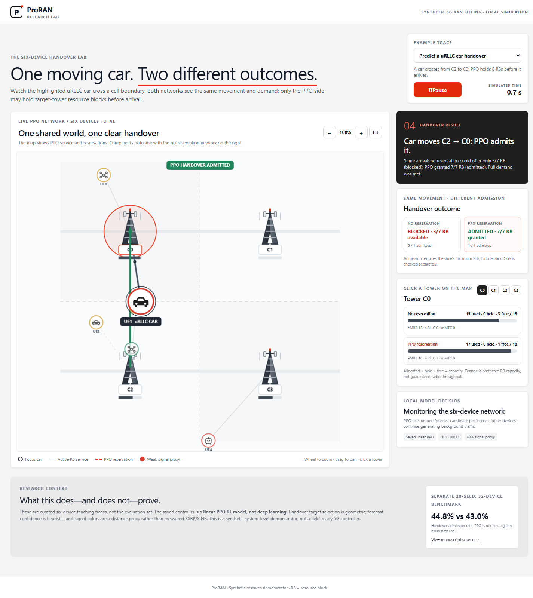

# Proactive 5G RAN handover reservation

This repository is a reproducible **synthetic system-level** research artifact for proactive RB reservation during network-sliced handovers. It implements a four-cell 2D mobility/traffic simulator, masked categorical PPO, five baselines, matched-seed benchmarking, live visualization, high-resolution figures, and an IEEE-style paper. It is not a validated live 5G stack.

## Six-device web walkthrough

Start the production Waitress server:

```powershell
.\bootstrap.ps1
.\.venv\Scripts\python.exe -m web.server
```

Then open [http://127.0.0.1:8080](http://127.0.0.1:8080). The web UI has **one large zoomable map with exactly six simulated devices**, because baseline and PPO share identical exogenous movement. Zoom with +/− or the mouse wheel, drag to pan, and use Fit to reset the viewport. The no-reservation and saved-PPO outcomes, RB ledgers, and model decision sit beside the map. It has two curated teaching traces and one pause/resume playback control. The focus car has an animated RB-service link, dashed target-reservation path, and handover arrow; other devices remain visible but subdued. Click any isometric tower SVG for its eMBB/uRLLC/mMTC resource ledger. The red/amber/green rings show a **distance-to-serving-cell proxy** (`max(0, 1 − distance/48)`), not measured RSRP/SINR. Icons are visual classes only; they share the same mobility/radio model. Set `PRORAN_HOST` or `PRORAN_PORT` to change the bind address. If port 8080 is occupied, set `PRORAN_PORT=8081` and open that port instead. The UI refuses to start a comparison if the saved PPO model is missing.



Container deployment is also supported:

```powershell
docker build -t proran-ui .
docker run --rm -p 8080:8080 proran-ui
```

The supplied notes and PreNS paper motivated the project. The implementation deliberately does **not** use PreNS's printed confidence/variance fusion because its terms have incompatible physical units. A synthetic, uncalibrated forecast score, configured target-noise rate, and normalized demand deviation remain separate state variables.

## Reproduce

PowerShell on Windows:

```powershell
.\bootstrap.ps1
.\.venv\Scripts\python.exe -m pytest -q
.\.venv\Scripts\python.exe -m proran experiment --output results
```

With the web server running, `node tests/browser_smoke.mjs` additionally checks canvas rendering, pause/resume, tower selection, scenario switching, responsive layout, and uncaught browser errors (Node.js and Microsoft Edge required). Set `PRORAN_URL` if using a non-default port.

The actor is behavior-cloned from a balanced uncertainty-aware demonstration set, fine-tuned with PPO for 60 episodes, then evaluated with six policies on 20 held-out matched seeds and a nine-point sensitivity sweep. To reuse the saved model:

```powershell
.\.venv\Scripts\python.exe -m proran experiment --output results --no-retrain
```

On the fixed held-out suite, PPO reaches 44.82% handover success and 38.45% QoS satisfaction, compared with 43.03% and 37.19% for no-reservation 5G. The paired gains are 1.79 percentage points (95% CI 1.34–2.25) and 1.26 points (CI 0.86–1.66), respectively. PPO is *not* best overall: the uncertainty-aware heuristic reaches 46.72% success, and certainty-equivalent reservation reaches 49.73%, at higher RB occupancy. The UI and paper retain all dimensions of that trade-off.

An additional exploratory eight-seed scenario audit uses the saved model in frozen 26–44-device urban, rush-hour, highway, and elevated-uRLLC-burst settings. Those workloads are independent of the six-device web demonstrations. It reports positive paired point estimates against no reservation in all four settings but is not a field-validation claim. Reproduce it with `.\.venv\Scripts\python.exe -m web.scenario_audit`; see `results/scenario_audit.csv`.

## Live showcase

The terminal dashboard works without a desktop GUI:

```powershell
.\.venv\Scripts\python.exe -m proran showcase --terminal --frames 160
```

Open a GUI animation where Tk is available, or render a portable GIF headlessly:

```powershell
.\.venv\Scripts\python.exe -m proran showcase
.\.venv\Scripts\python.exe -m proran showcase --save results/showcase.gif --frames 160
```

UE color denotes eMBB/uRLLC/mMTC, dashed links denote pending or active reservation contracts, the cell panel shows allocated/reserved/free RBs, and event text reports activation and instantaneous handover results.

## Outputs

- `results/benchmark_metrics.csv`: means and standard deviations for every metric/method.
- `results/per_seed_metrics.csv`, `paired_comparisons.csv`: all 120 run-level summaries and paired 95% confidence intervals.
- `results/latency_samples.csv`: per-attempt modeled latency with method, seed, and slice ID.
- `results/scenario_audit.csv`: exploratory eight-seed paired checks in four web scenarios.
- `results/results.json`: simulation/training configuration, seeds, and metrics.
- `results/training_history.csv`, `ppo_model.npz`: optimization trace and learned parameters.
- `results/imitation_history.csv`, `imitation_model.npz`: balanced behavior-cloning trace and pre-PPO checkpoint.
- `results/figures/`: 350-dpi PNG and vector PDF learning, Pareto, and per-slice latency-CDF figures.
- `results/showcase.gif`: animated topology and RB ledger.
- `results/results_macros.tex`: measured values consumed directly by `paper.tex`.
- `paper.tex` and `references.bib`: fully populated IEEE Transactions-style manuscript.

Compile the paper in a TeX distribution that provides `IEEEtran`:

```powershell
pdflatex paper.tex
bibtex paper
pdflatex paper.tex
pdflatex paper.tex
```

## Model and accounting

One interval is ordered as decision, due activation, incumbent allocation, motion/handover, then release/expiry. Integer allocations plus active reservations never exceed cell capacity. A reservation made for a wrong cell cannot serve the actual handover; an early arrival cannot use a pending reservation; rejected activations occupy no capacity; failed handovers use no reserved RBs. Zero denominators are undefined rather than silently reported as zero.

The action catalog is no-op plus half/full predicted demand activated now, halfway to the forecast arrival, or one interval before it. The legal-action mask is part of the PPO distribution and is saved for updates. The linear actor/critic uses clipped PPO and GAE without a heavyweight deep-learning dependency. **This is RL/ML, not deep learning.** PPO chooses reservation amount and timing; the nearest-cell mobility rule chooses the destination cell. The forecast probability is a heuristic score and is not statistically calibrated.

## Scope

This is a synthetic, system-level research simulator—not a 3GPP-conformant PHY/MAC or field-performance claim. Channel quality, HARQ, beam management, and signaling are abstracted. The published metrics demonstrate controlled algorithmic trade-offs and reproducibility; integration with ns-3/OAI and a calibrated mobility/demand predictor is future work.
