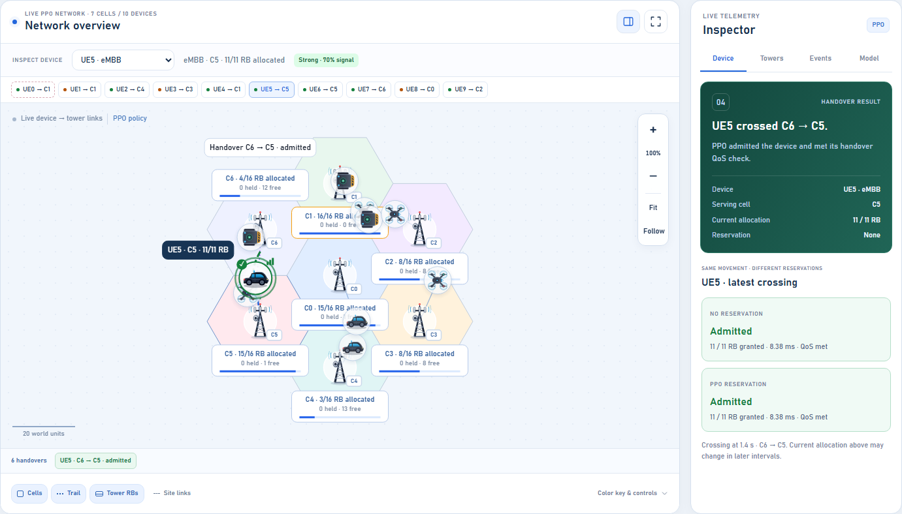

# ProRAN: predictive 5G handover lab

ProRAN is a reproducible synthetic system-level simulator for proactive resource-block (RB) reservation during network-sliced handovers. It combines a live network lab, a trained neural mobility/demand predictor, QoS-aware cell selection, a legacy masked PPO controller, and matched-seed research benchmarks.

Radio, signaling, and packet scheduling are abstracted. Signal and latency values are modeled proxies; results do not establish field performance or 3GPP conformance.

## Run locally

Use Python 3.10 or newer (the Windows bootstrap uses Python 3.12). Run commands from the repository root so the server can locate the supplied models and research artifacts.

On Windows:

```powershell
.\bootstrap.ps1
.\.venv\Scripts\python.exe -m web.server
```

On Linux or macOS:

```sh
python3 -m venv .venv
. .venv/bin/activate
python -m pip install -r requirements-dev.txt -r requirements-web.txt
python -m pip install -e . --no-build-isolation
python -m web.server
```

Open [localhost:8080](http://127.0.0.1:8080). Set `PRORAN_HOST` or `PRORAN_PORT` to change the bind address. For example, `$env:PRORAN_PORT = "8081"` in PowerShell selects port 8081.

The supplied models let you run the lab without retraining. The default controller is **Deep forecast + QoS target**. You can also select the neural forecaster with nearest-cell targeting or the legacy linear PPO controller. Four scenarios include a seven-cell cluster, two six-device teaching traces, and a five-cell overlap.

Choose a device, pause to inspect a decision, or replay the same seed. Tower cards display allocated, held, and free RBs; links show each device's serving cell. Zoom with the wheel, pinch, or +/- controls, and drag to pan. With the canvas focused, arrows pan, F fits, and Space pauses. Expand the map for more room; Escape restores the workspace.



## Verify the code

Use the virtual environment's Python (`.\.venv\Scripts\python.exe` on Windows):

```sh
python -m pytest -q
python -m ruff check src web tests
python -m ruff format --check src web tests
python -m compileall -q src web
```

GitHub Actions runs these checks for pushes and pull requests. To apply standard Python formatting, run `python -m ruff format src web tests`.

With the server running, these browser checks exercise the linear teaching traces and neural controller UI:

```sh
node tests/browser_smoke.mjs
node tests/browser_research_validation.mjs
```

They require Node.js 22 or newer and Microsoft Edge. Set `PRORAN_BROWSER` to another Chromium executable and `PRORAN_URL` for a different server URL. Browser checks write screenshots and reports under `results/`.

## Reproduce research outputs

The original linear PPO experiment is kept separately from the neural experiments:

```sh
python -m proran experiment --output results --no-retrain
python -m web.verify_simulation
python -m web.scenario_audit
```

Omit `--no-retrain` to retrain the legacy actor. It uses behavior cloning followed by masked categorical PPO with clipped updates and GAE. PPO chooses reservation amount and timing; nearest-site geometry chooses the destination cell.

For the neural workflow, these commands retrain the predictor or replace associated reports. Run only the stages you intend to regenerate:

```sh
python -m proran.neural
python -m proran.deep_experiment
python -m web.research_report
python -m proran.research_validation
python -m proran.research_report
python -m proran.robustness_validation
python -m proran.training_variability
```

The predictor is a 35-64-32-24 multilayer perceptron with two tanh hidden layers and an eight-interval forecast horizon. Training, validation, and held-out trajectory seeds are separated. QoS-aware targeting uses coverage, hysteresis, and time-to-trigger safeguards. Target policies can produce different handover counts, so compare whole-network service metrics alongside event rates. Forecast scores are uncalibrated.

Saved validation reports retain the provenance of the runs that generated them. Reports containing source hashes describe that recorded source version; regenerate them when validating a changed simulator.

## Project layout

| Path | Purpose |
| --- | --- |
| `src/proran/` | Simulator, geometry, controllers, training, experiments, plotting |
| `web/server.py`, `web/static/` | Flask/Waitress API and interactive canvas workspace |
| `tests/` | Python regression tests and browser checks |
| `results/` | Legacy PPO models, matched-seed metrics, plots, current UI previews |
| `results/deep/` | Neural predictor, training metadata, neural-controller benchmarks |
| `results/research_validation/` | Independent forecasting and whole-network service checks |
| `results/robustness_validation/`, `results/training_variability/` | Workload and initialization sensitivity studies |
| `paper.tex`, `references.bib` | Original IEEE-style manuscript and bibliography |
| `research_validation.tex` | Supplement using independently generated tables and figures |
| `rl_handover_pseudocode.tex` | Controller pseudocode |
| `PROJECT_EQUATIONS.md`, `SIMULATION_REVIEW.md` | Proposed specification and historical simulation audit |

Local exploratory training directories, browser profiles, Python caches, and TeX compilation intermediates are ignored. Measured research data and models remain versioned for reproducibility.

## Accounting and scope

Each interval processes decisions, due activations, incumbent allocation, motion/handovers, and release/expiry. Integer allocations plus active holds cannot exceed cell capacity. Pending contracts occupy no RBs; wrong-target or not-yet-active reservations cannot serve an arrival. Successful admission consumes matching reserved RBs and releases surplus. Admission, full-demand service, QoS, and modeled latency are distinct measurements; rates with no attempts remain undefined.

One interval represents 0.1 seconds. The seven-cell live scenario uses a union of regular hexagons with reflecting outer boundaries; the original benchmark uses a square domain. Different controllers share seeded exogenous workloads, while their assignments and outcomes can differ.

Channel quality, HARQ, beam management, signaling, and packet-level throughput are abstracted. The supplied PreNS paper and notes motivated the formulation; confidence, target noise, and normalized demand deviation remain separate quantities.

## Container and manuscript

```sh
docker build -t proran-ui .
docker run --rm -p 8080:8080 proran-ui
```

The container includes both saved controller models and runs Waitress as an unprivileged user. A TeX distribution with `IEEEtran` can compile the original paper:

```sh
pdflatex paper.tex
bibtex paper
pdflatex paper.tex
pdflatex paper.tex
```

Generate the research report before compiling `research_validation.tex` so its macros, tables, and figures exist.
